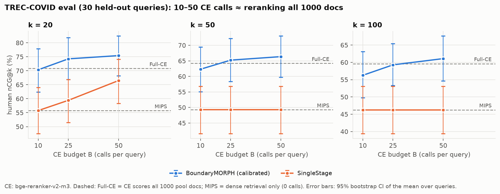
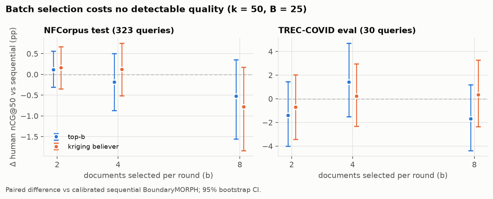
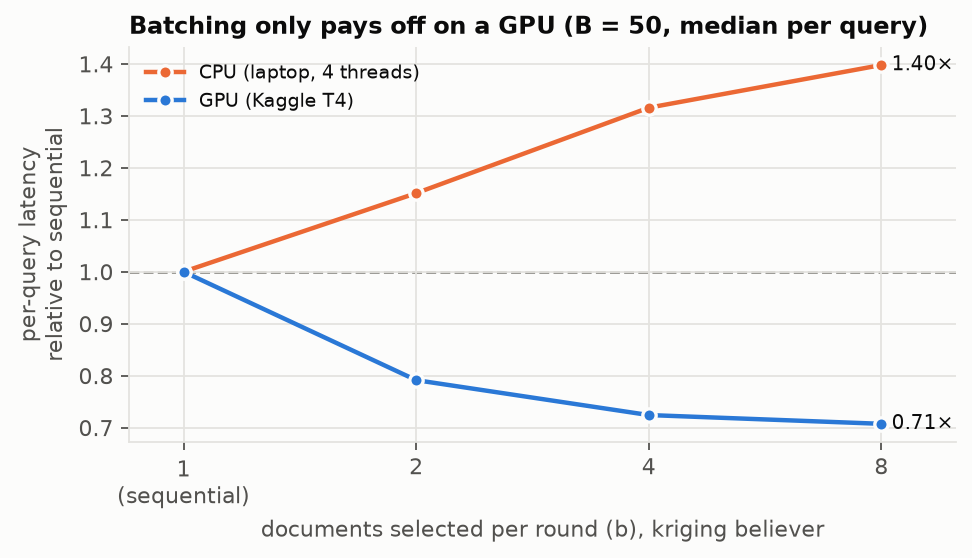

# Parallel Boundary-Aware Reranking

**Can budgeted cross-encoder reranking select several documents per round without losing
quality, and does that actually make it faster?**

[BoundaryMORPH](https://arxiv.org/abs/2609.27213) (Caplan et al., 2026) spends a small
cross-encoder (CE) budget *B* on the documents whose membership in the top-*k* is most
uncertain. A Gaussian process propagates each CE score to unscored neighbours. The paper notes
that the method is strictly sequential, since every CE call waits for the previous posterior
update, and leaves batch acquisition as future work. This project implements that future work
and tests it on two BEIR datasets, with held-out evaluation, paired statistics, and measured
(not assumed) latency.

## TL;DR

1. **Reproduction.** With a strong CE, BoundaryMORPH works as the paper claims. On TREC-COVID
   (30 held-out queries), **10–50 CE calls match ranking all 1000 candidates by the CE**
   (Δ −3.3 to +4.6 pp nCG, none significant). They also **beat dense retrieval by +10 to +20 pp and
   standard top-B reranking by +9 to +17 pp** (all 18 comparisons significant after Holm correction).
2. **Batch selection is quality-neutral.** Choosing *b* = 2–8 documents per round (top-b boundary
   pairs or a kriging-believer batch) stays within **±0.9 pp** of sequential selection on NFCorpus
   test (323 queries, 0/54 differences significant on human labels). TREC-COVID shows no
   detectable loss either, with wider CIs.
3. **Whether it is faster depends on hardware, and I measured it.** On a T4 GPU, selecting 8 per
   round cuts per-query latency by **26–36%**. On a laptop CPU it makes queries **~40% slower**,
   because batched CE inference is slower per document there (padding, already-saturated cores).
4. **A failure mode of the paper's prior, plus a fix.** The rank-percentile prior assumes CE scores on
   a ~[0,1] percentile scale. With a CE whose scores are skewed toward 0, scoring a document almost
   always *ejects* it from the top-k, and the method falls below zero-call retrieval. A
   **calibrated rank prior** (isotonic E[CE score | rank], cross-fitted on other queries) removes the
   failure.





## Setup

| | NFCorpus | TREC-COVID |
|---|---|---|
| Corpus / queries | 3.6k docs; dev 324, test 323 | 171k docs; 50 queries → tune 20 / eval 30 (deterministic split) |
| Relevant docs per query (median) | ~16–18 | ~480 (the "diffuse" regime the paper targets) |
| Candidate pool | top-1000 by `e5-base-v2` (MIPS) | same (fp16) |
| Cross-encoder | `ms-marco-MiniLM-L-6-v2` (chosen on dev from 4) | `bge-reranker-v2-m3` (chosen on tune); MiniLM as a secondary condition |
| Tuning → held-out | dev → test, run once | tune → eval, run once |

* **Grid:** budgets B ∈ {10, 25, 50}, context sizes k ∈ {20, 50, 100}, batch sizes b ∈ {1, 2, 4, 8}.
  Every method spends exactly B CE calls, in ⌈B/b⌉ sequential rounds.
* **Methods:**
  * baselines: MIPS (0 calls), SingleStage (CE on MIPS top-B), Full-CE (CE on all 1000);
  * sequential BoundaryMORPH (paper prior and calibrated prior), plus the paper's ablations
    (no prior, max-σ acquisition);
  * batch variants: top-b boundary pairs, kriging believer and kriging liar;
  * a random-boundary control.
* **Metrics, kept separate:**
  * **nCG@k** on human qrels (end quality);
  * **CE-nCG@k** (fidelity to the CE's own top-k, i.e. selection quality independent of CE errors);
  * nDCG@10 (ordering);
  * CE calls, rounds, and **measured** wall-clock split into CE time and GP overhead.
* **Statistics:** paired per-query bootstrap 95% CIs (the primary evidence), Wilcoxon with Holm
  correction (secondary; tied, skewed differences make it overconfident at sub-pp effects).

## Results in more detail

All numbers below come from `results/…` via the scripts. The full log, with every intermediate and
negative result, is in [docs/FINDINGS.md](docs/FINDINGS.md) (F1–F11).

**TREC-COVID eval, human nCG, calibrated sequential BoundaryMORPH (paired 95% CI)**

| k | B | MORPH | vs MIPS | vs SingleStage | vs Full-CE (1000 calls) |
|---|---|---|---|---|---|
| 20 | 10 | 70.3 | +14.6 [+8.8, +20.5] | +14.6 [+8.8, +20.5] | −0.5 [−7.6, +5.9] |
| 50 | 25 | 65.2 | +16.0 [+10.9, +21.6] | +16.0 [+10.9, +21.6] | +1.0 [−1.8, +3.9] |
| 100 | 50 | 61.1 | +14.8 [+10.1, +20.4] | +14.8 [+10.1, +20.4] | +1.5 [−1.2, +4.3] |

**Latency, B = 50, median per query (s)**

| | sequential | KB b=2 | KB b=4 | KB b=8 | top-b b=8 | SingleStage (1 batch) |
|---|---|---|---|---|---|---|
| CPU (laptop) | 2.93 | 3.37 | 3.85 | 4.10 | 4.21 | 4.70 |
| GPU (T4) | 0.737 | 0.583 | 0.534 | 0.521 | **0.473** | 0.346 |

The GP overhead is 0.1–0.18 s per query. That is negligible on CPU but 22–42% of the total on GPU,
which is why top-b (no extra posterior updates per pick) is the fastest batch variant.

## What did *not* work, or did not replicate

* **NFCorpus cannot show human-label gains.** None of four CEs (MiniLM-L-6/L-12, bge-reranker-base,
  bge-reranker-v2-m3) beats e5 when it ranks the full 1000-doc pool. Rerankers only help, slightly,
  on shallow top-20 reranking. On NFCorpus test, calibrated MORPH vs MIPS on human nCG is −0.7 to
  +0.7 pp (all CIs include 0), even though CE-nCG improves by up to +10 pp. A dev-split gain of
  +1.8 pp at k=20 **did not replicate on test**.
* **The acquisition rule matters less than expected.** Random sampling from the boundary band is
  4–9 pp worse on NFCorpus but within ~2.5 pp on TREC-COVID. There, most of the gain comes from
  the prior plus GP propagation, which is consistent with the paper's own ~2 pp acquisition ablation.
* **Small eval set.** TREC-COVID has 50 queries in total, so its batching bounds are loose (CIs up
  to ±8 pp in the noisiest cells). The tight equivalence evidence comes from NFCorpus.

## Paper faithfulness

Implemented from the paper's Alg. 1/2 and App. B: vMF kernel with a median-heuristic κ, rank
prior, query as a zero-cost y = 1 observation, residual z-standardised GP, standardised boundary-gap
acquisition, and a final top-k with scored docs at their CE score. Unspecified details were resolved
explicitly and are configurable: μ0(query), std(e) with a single observation, tie-breaking, and one
shared embedder for pool and kernel. See [docs/PLAN.md](docs/PLAN.md) §2 and §6. Absolute numbers are
not comparable to the paper, which used different datasets, a 10k pool, Qwen3/zerank models, and
an A10G GPU.

## Reproduce

```bash
python -m venv .venv-pbar && .venv-pbar/Scripts/activate        # bin/activate on Linux/macOS
pip install torch --index-url https://download.pytorch.org/whl/cpu
pip install -e .[dev] && pytest                           # 80 tests

# Heavy steps (embeddings, CE scores of all pools) run once on a GPU. A free Kaggle T4 works:
python scripts/make_kaggle_kernel.py OUT --kernel-id <user>/<slug> --splits dev test \
    --gpu0 cross-encoder/ms-marco-MiniLM-L-6-v2 --pool-size 1010     # or --command "..." for anything else
kaggle kernels push -p OUT && kaggle kernels output <user>/<slug> -p dl/   # unzip dl/cache.zip here

# Everything else replays cached CE scores through a budget-enforcing oracle (minutes on CPU)
python scripts/run.py configs/final_test.yaml --workers 4
python scripts/run.py configs/trec_covid_eval.yaml --workers 4 --ce-model BAAI/bge-reranker-v2-m3 --ce-fp16
python scripts/analyze.py results/<run> --metric ncg_pool --ref 'morph|{"batch_size": 1, "prior": "calibrated"}'
python scripts/latency.py configs/latency.yaml          # live CE timing on this machine
python scripts/make_figures.py
```

## Layout

```
src/pbar/
  data.py           BEIR loading, deterministic query splits
  retrieval.py      dense pools; QueryContext
  crossencoder.py   CE scorer and a score cache keyed by (qid, doc), robust across machines
  oracle.py         budget-enforcing CE oracle (cached replay or live)
  gp.py             residual GP posterior (paper Alg. 1)
  calibration.py    calibrated rank prior (isotonic, cross-fitted)
  selectors/        baselines, sequential BoundaryMORPH, batch variants
  experiment.py     config → parallel grid → per-query results + bootstrap summary
  latency.py        live timing harness and CE micro-benchmark
  metrics.py, stats.py
configs/            one YAML per experiment; frozen held-out configs are marked FROZEN
scripts/            run, analyze, latency, compare_ce, precompute, make_kaggle_kernel, make_figures
docs/               PLAN.md (method, faithfulness, limitations), FINDINGS.md (F1–F11), figures/
tests/              80 tests: metrics, oracle budget, GP vs dense reference, b=1 equivalence,
                    cross-fit leakage, cache alignment, pool cache, latency harness
```
